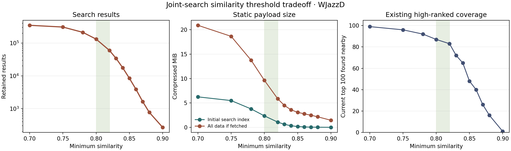

# What a joint-search similarity cutoff would retain

I analyzed **all 360,578** containment-filtered results in the experimental
WJazzD joint-search database, recomputed each stored alignment's pitch,
onset, duration, and skip costs, and checked that every recomputed total
agreed with the stored cost. The threshold means `similarity >= t`, where
`similarity = 1 - cost/(paired notes + skipped notes)`. The source checksum
and full reproducible figures are in
[`data/joint-threshold-analysis.json`](data/joint-threshold-analysis.json).

## Results and actual compressed size

The size columns are **measured gzip bytes**, not a proportional estimate of
the SQLite file. I encoded a compact JSON search index with solo metadata and
result summaries, alignment details in 1,024-result shards, and full note data
in one file per used solo. “Initial” is the search index fetched at page load;
“all” adds every detail shard and every used solo's notes, even though a normal
visitor would load only the passages they open. MiB means 1,048,576 bytes.
Artwork, audio, video metadata, reviews, and app code are excluded.

| Minimum similarity | Results | Initial gzip MiB | All data gzip MiB | Existing top 100 found nearby |
| ---: | ---: | ---: | ---: | ---: |
| none | 360,578 | 6.50 | 21.64 | 99 |
| 0.75 | 307,905 | 5.49 | 18.64 | 96 |
| 0.78 | 212,140 | 3.78 | 13.75 | 92 |
| **0.80** | **131,822** | **2.35** | **9.63** | **87** |
| 0.82 | 59,690 | 1.08 | 5.86 | 83 |
| 0.83 | 34,057 | 0.63 | 4.50 | 72 |
| 0.84 | 17,590 | 0.33 | 3.60 | 65 |
| 0.85 | 8,436 | 0.17 | 3.08 | 48 |
| 0.86 | 3,860 | 0.09 | 2.77 | 40 |
| 0.88 | 766 | 0.03 | 2.17 | 16 |
| 0.90 | 269 | 0.01 | 1.46 | 1 |

“Found nearby” means that a new window overlaps at least 65% of the shorter
window in **both** solos. The reference is the current miner's top 100 by its
own heuristic score. It is a continuity check, **not** a listener-approved
measure of musical quality. At no cutoff, the new method already misses one
of the current top 100. The current top 1,000 coverage falls from 941 with
no cutoff to 755 at 0.80, 637 at 0.82, and 305 at 0.85.

The 0.80 initial index is 7.27 MiB before gzip. The complete experimental
SQLite database is 86.86 MiB on disk; it includes indexes and a very
different representation, so its size should not be used to estimate a
static-site download.

## What the thresholds select

| Threshold | Median / 90th-percentile paired notes | At least 12 paired notes | Results with a skipped note | Cross-performer, different-composition results |
| ---: | ---: | ---: | ---: | ---: |
| none | 9 / 11 | 26,630 | 5.48% | 344,834 |
| 0.80 | 9 / 11 | 8,650 | 1.46% | 124,811 |
| 0.82 | 9 / 12 | 6,371 | 1.50% | 56,033 |
| 0.84 | 10 / 13 | 3,842 | 1.76% | 16,203 |
| 0.85 | 10 / 13 | 2,490 | 1.84% | 7,636 |

The cost decomposition is informative: across all results, **55.8%** of
accumulated cost is pitch disagreement, **23.2%** onset-gap disagreement,
**18.0%** duration disagreement, and **3.1%** skipped notes. Above 0.82,
those shares are **65.8%, 18.3%, 15.0%, and 1.0%**. These are shares of
penalty, not independent similarity scores. Pitch and rhythm both contribute,
but the retained results' residual cost is mostly pitch.

Higher similarity also modestly favors repeat material: same-performer pairs
rise from **4.1%** of the full set to **5.0%** at 0.80 and **9.0%** at 0.85;
same-composition pairs rise from **0.48%** to **0.58%** and **1.23%**. These
categories overlap and are descriptive, not proof of relevance.

The cutoff particularly affects ornamented alignments. The full database
contains **19,760** passages with at least one skipped note. Only **1,919**
remain at 0.80, **896** at 0.82, and **155** at 0.85. Some low-similarity
gapped results may be coincidences; others may be the added-note cases we
intended to find. The data alone cannot tell us which.

There is no clear natural break in similarity. Tightening 0.80 to 0.82 saves
only **1.27 MiB** of initial transfer but removes **72,132** results and
**2,279** passages with at least 12 paired notes. Tightening further to
0.85 saves less than another 1 MiB initially while reducing current-top-100
coverage from 83 to 48. At the other end, keeping everything needs a 6.50
MiB initial index and asks the browser to sort/filter 360,578 rows.

## Recommendation

For a **first static prototype**, use **0.80 as the hard export floor** and
retain the full experimental database offline. It gives a 2.35 MiB initial
download and a 9.63 MiB compressed total if every detail and solo note file
is fetched, while preserving substantially more long and gapped passages
than 0.82–0.85. The browser can still default to a stricter filter or show
only the strongest results first without discarding the 0.80–0.82 band.

This is a size-and-coverage decision, **not a validated relevance threshold**.
No listener reviews are saved. Before treating 0.80 as permanent, listen to
the existing [`data/search-review-sample.csv`](data/search-review-sample.csv)
and add a sample of gapped matches and current-high-ranked matches lost below
0.80. In particular, review whether the skip cost of 1 and the local budget
of 2 are suppressing useful ornaments; a different cost model could change
the threshold distribution entirely.

## Corpus boundary

The experimental similarity exists only for **456 WJazzD solos (200,809
notes)**. The app's current index also covers **120 JTD piano performances
(285,883 projected top-line notes)**; it has 8,734 JTD–WJazzD and 932
JTD–JTD result pairs. Of the current top 1,000, **195 involve JTD**. The JTD
import currently rounds beat positions down to whole beats, so applying the
new rhythm cost to it would be misleading until the import is repaired and
rebuilt. The local DTL1000 cache contains note data for 750 of 1,685 catalog
solos, with unresolved timing discrepancies, and is not in either complete
search corpus. Thus the threshold figures cannot yet be claimed for **all
three** collections.

Reproduce this report's machine-readable data with
`python3 -m jazzmine.threshold_analysis`. The program reads the WJazzD
source and complete experimental index, validates every passage cost, and
writes `data/joint-threshold-analysis.json`.
